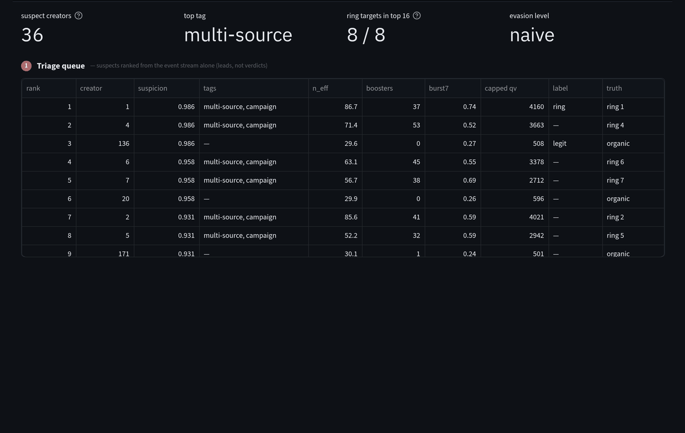
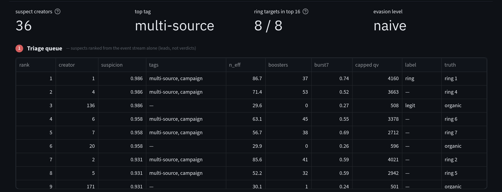

# fraud-ring-detection

A seeded simulator, reference detector and evaluation harness for coordinated fraud rings, with an
investigator UI. It measures how well you catch rings against an adversary that tries harder and
harder to look organic, without needing a single real label.



**Jump to:** [What's in the box](#whats-in-the-box) · [Install](#install) · [Try it](#try-it) ·
[Results](#results) · [How it's measured](#how-its-measured) · [Research](#research) ·
[Layout](#layout)

Labeled data for coordinated fraud is private everywhere, which makes most fraud detectors
impossible to evaluate honestly. This project builds the world first: a platform where accounts view
items published by creators, and creators are paid per qualified view. Fraud rings are injected to
inflate chosen creators' payouts, alongside the honest populations that make naive detectors look
good — superfans, passive viewers, bandwagon crowds, people who share a household IP. The detector
never sees the answer key, and every result is a curve over how sophisticated the adversary is.

## What's in the box

- **A world generator** (`fraudrings.generator`). Seeded and deterministic, with an **evasion dial**
  — `naive`, `moderate`, `sophisticated` — that controls infra rotation, timing jitter, completion
  spoofing, funnel faking, account aging, and splitting the same payout across more accounts. A
  **lock-step** mode makes each ring a finite operator that can only run C accounts at once.
- **A seeded detector** (`fraudrings.detector.engine`). Start from a few suspect accounts and recover
  the rest of the ring: rarity-gated link-then-score over shared infrastructure, co-target widening,
  and a four-axis evidence score — linkage, behavioral, co-target, action mix.
- **A seedless ranker** (`fraudrings.detector.concentration`). Shortlist the creators whose views
  concentrate — on few accounts, on many dedicated ones, or inside one week — from the event stream
  alone. It outputs suspects, not verdicts.
- **An evaluation harness** (`fraudrings.eval`). Degradation curves over the dial, a learned rule
  graded on held-out rings against a fixed bar, a noisy-oracle learning curve that prices human
  labels, and a grader for the seedless ranker.
- **An investigator UI** (`fraudrings view`). A Triage page for the seedless shortlist and an
  Investigate page for the seeded engine, with a one-click handoff between them, explainable score
  breakdowns, lasso-to-reseed charts, a temporal raster, and labeling that's graded against hidden
  truth.

## Install

You need Python 3.11+. Linux and macOS are supported.

```sh
pip install "fraud-ring-detection[viz,ml] @ git+https://github.com/stephen-corgiat/fraud-ring-detection"
```

`viz` adds the UI (Streamlit, Plotly), and `ml` adds the learned rule (scikit-learn, LightGBM). The
core — generator, detector, sweep — needs neither.

## Try it

```sh
fraudrings view
```

This opens the investigator in your browser. Pick a world in the sidebar. The **Triage** page ranks
suspect creators from raw events. Open one, read why it ranked, and hand its dedicated core to
**Investigate**, which recovers the rest of the ring.

[**The walkthrough**](docs/walkthrough.md) is a complete illustrated case through both pages, with
every screen reproducible from a deep link.



The experiments run from the command line:

| Command | What it does |
|---|---|
| `fraudrings run` | Generate one world, investigate every ring from three seeds, print per-ring recovery. |
| `fraudrings sweep` | Turn the evasion dial and report the ranking curve and the operational curve. |
| `fraudrings grade` | Grade the learned rule on held-out rings against the success bar. Needs `[ml]`. |
| `fraudrings curve` | Learning curve: held-out metric vs. number of oracle labels, with label noise. Needs `[ml]`. |
| `fraudrings rank` | Grade the seedless ranker: where the rings' target creators land on the shortlist. |

Every command takes `--preset smoke` for a tiny world and `--seeds 7,13,21` to average seeds.

## Results

Default preset, averaged over seeds 7, 13 and 21. The raw numbers are in [`docs/results/`](docs/results/).


- **Ranking degrades; the operational line holds.** As rings move onto residential infrastructure,
  per-ring AP falls from 1.00 to 0.50. Operational precision — the share of actioned accounts that are
  fraud in *any* ring — stays at 0.95, because the loss is rings being confused with each other, not
  genuine users being flagged.
- **The learned rule clears the bar at every level, on every seed.** The bar is operational precision
  ≥ 0.90, recall ≥ 0.80 and legit false positives ≤ 5%, on rings held out of training. At sophisticated
  it lifts recall from 0.37 (hand-weighted) to 1.00, with legit false positives at 4%.
- **The seedless ranker finds naive and moderate rings near the head of the list.** At sophisticated,
  half the ring targets sink into the tail, since rings spread views across cover creators.


- **Labels-to-target:** a perfect oracle needs 10 labels at naive and 80 at sophisticated to clear
  the bar and keep clearing it.
- **Precision is the fragile constraint.** Under symmetric label noise the legit-FP line drifts onto
  the 5% bar long before recall suffers. Missed fraud, the realistic error, is benign: at 20% missed
  fraud the bar is still reached, at 160 labels.
- **Active learning helps first, not durably.** Uncertainty sampling reaches the recall bar at half
  of random's budget, but its false positives wobble back over 5%.

## How it's measured

The point of the project is the measurement discipline. In short:

- **The answer key is physically separate.** The generator writes events and ground truth to
  different files; the detector never opens the latter.
- **The adversary is a dial,** and results are curves.
- **Honest negatives are first-class populations,** so no single cue is a free answer.
- **Grading uses rings the model never saw,** with the near-perfect tell held out of the headline.
- **The human is priced,** with a noisy oracle.
- **New generator features draw from isolated random streams,** so they can't silently move existing
  results.

[`docs/research/method.md`](docs/research/method.md) walks through it end to end. The eight
[decision records](docs/adr/) explain each choice, including a documented negative result: lock-step
serialization is real but not recoverable from timing
([ADR 0004](docs/adr/0004-lockstep-serialization-is-not-recoverable.md)).

## Research

The design was made against a reading of about thirty papers and industry sources:
- dense-subgraph and lock-step detection (FRAUDAR, fBox, CopyCatch, SynchroTrap);
- abusive-account classification (Deep Entity Classification);
- positive-unlabeled and noisy-label learning;
- strategic classification and performative prediction;
- bot and LLM-agent fingerprinting, and residential proxy networks;
- the *Dos and Don'ts of ML in Security* pitfalls.

The approach was also exercised against real production traffic.

- [Literature review](docs/research/literature-review.md) — what each source claims, and what this
  project took from it or deliberately didn't.
- [Lessons](docs/research/lessons.md) — sixteen working rules for building and evaluating detectors
  against adaptive adversaries.
- [Explainer lessons](https://stephen-corgiat.github.io/fraud-ring-detection/explainer/) — the detector in seven short, plain-language lessons, each
  with a quiz.

## Layout

| Path | Role |
|---|---|
| `src/fraudrings/generator/` | World simulator and the evasion dial |
| `src/fraudrings/detector/` | Ingest (features, identifier rarity), the seeded engine, the seedless ranker |
| `src/fraudrings/eval/` | Evaluation protocol, sweep, learned rule and grade, oracle and learning curve, ranker grader |
| `src/fraudrings/viewer/` | The Triage and Investigate pages, charts, label stores |
| `src/fraudrings/pipeline.py` | The `fraudrings` command |
| `docs/` | Walkthrough, decision records, research, results, images |
| `GLOSSARY.md` | The project's vocabulary |

## Contributing

See [CONTRIBUTING.md](CONTRIBUTING.md) for setup, tests, and how to regenerate the screenshots and
figures.

Licensed under [Apache-2.0](LICENSE).
