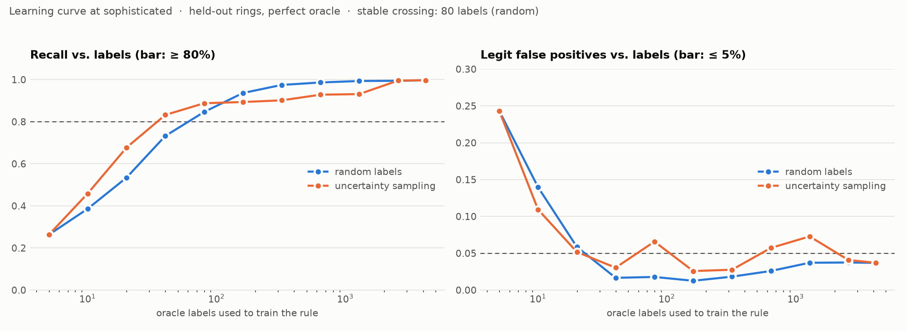

# Research

The ideas behind the project, in the order you'd want them: how to measure a detector when you have
no labels, what the literature says, and what this project would tell anyone building one.

- [Measuring a fraud-ring detector when you have no labels](method.md): the method, end to end. Build a
  world you know the answer to, turn the adversary into a dial, hold rings out, and price the labels.
- [Literature review](literature-review.md): about thirty papers and industry sources, each with what it
  claims and what this project took from it, or deliberately didn't.
- [Lessons](lessons.md): working rules for detectors against adaptive adversaries. They apply to any
  platform with coordinated abuse.
- [Decisions](../adr/): the design decisions, one record each.

## What the results look like

Every result is a curve over how hard the adversary tries to look organic. The full tables are in the [README](../../README.md#results).

<!-- chart: results-dial -->

<!-- chart: results-learning-curve -->
