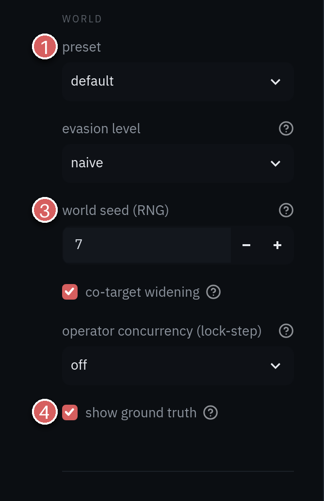
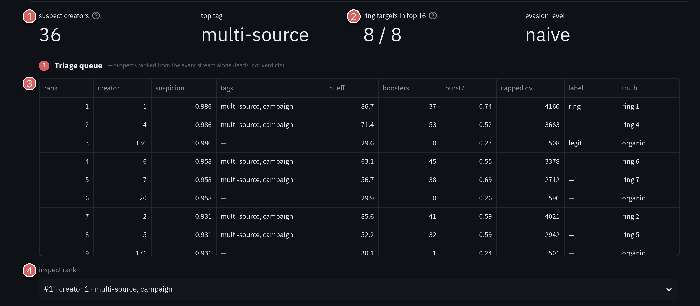
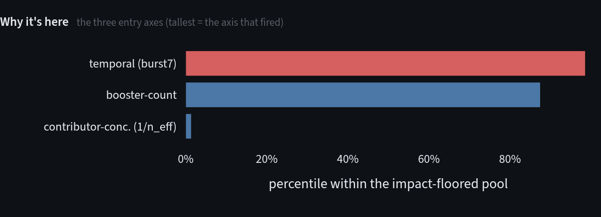
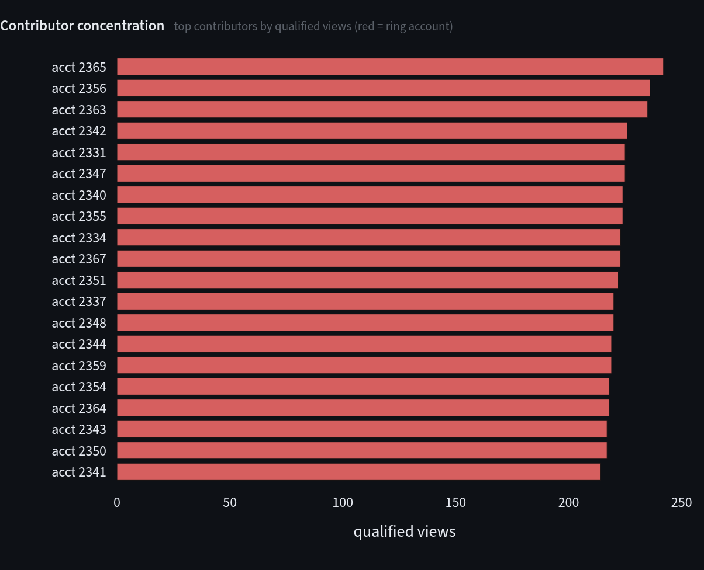
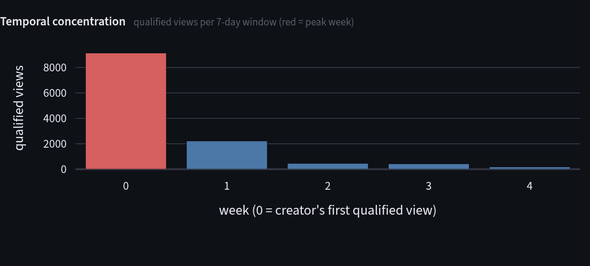
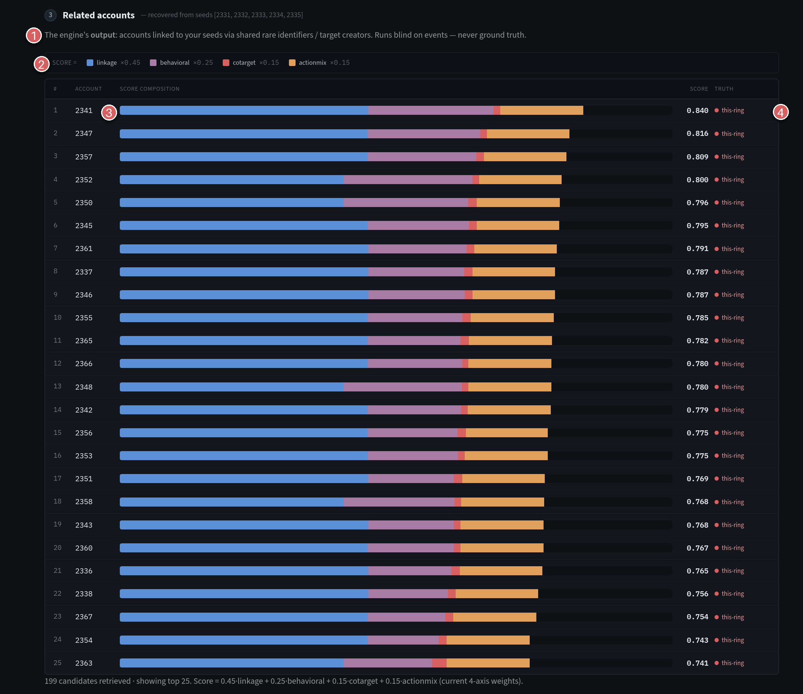

# Tour

Pick a simulated world, triage it, read a suspect, hand it to the investigator and turn the adversary's dial.
Steps 1 to 6 link to the exact view in the live app, so you can follow along without installing anything. The
app runs on a free tier and may take about 30 seconds to wake. The full case is in the
[walkthrough](walkthrough.md).

## 1. Install or open the live app

Nothing to install: [Open the live app ↗](https://fraud-ring-detection.streamlit.app/ "May take about 30 seconds to wake if it has been idle"). It runs on simulated data, and your labels stay in
your tab. To run it locally, from a clone of the repo:

```sh
python -m pip install -e ".[viz]"
fraudrings view
```

## 2. Pick a world

The sidebar picks the world; both pages read it.



1. **preset**: `default` is a few thousand accounts, `smoke` is a tiny world for quick checks.
2. **evasion level**: how hard the rings try to look organic, from `naive` to `sophisticated`. Each level
   is its own world.
3. **world seed (RNG)**: makes the world reproducible. Not the same as an investigation *seed*, which is an account.
4. **show ground truth**: reveals the answer key. Turn it off to work blind.

[Open this view in the live app ↗](https://fraud-ring-detection.streamlit.app/?preset=default&level=naive&seed=7 "May take about 30 seconds to wake if it has been idle")

## 3. Read the triage queue

You start with nothing but events. **Triage** ranks creators whose qualified views concentrate in ways
organic popularity rarely does.



1. **suspect creators**: every creator above the impact floor, ranked.
2. **ring targets in top 16**: with ground truth on, how many of the creators the rings were paid to boost
   land in the top 16 rows (16 is twice the number of targets).
3. **The queue**: one row per creator, with its suspicion score, its tags and, if truth is on, what it really
   is. Tags describe the shape of the audience. They are never a verdict.
4. **inspect rank**: pick any row to read the evidence behind it.

Each bar is the creator's percentile on one entry axis. The tallest is what put it on the list.

<!-- chart: triage-axes -->

[Open this view in the live app ↗](https://fraud-ring-detection.streamlit.app/?preset=default&level=naive&seed=7&rank=1 "May take about 30 seconds to wake if it has been idle")

## 4. Read a suspect

A real fan base is a staircase: a few regulars and a long tail. A fleet is a wall of comparable bars. With
ground truth on, ring accounts are red.

<!-- chart: triage-contributors -->

The second chart counts the same views by week. A paid campaign lands them in a single week.

<!-- chart: triage-weekly -->

An **evidence read** under the numbers is a cue, not a verdict. You make the call at the bottom of the page
(`ring`, `legit`, `unsure` or `escalate`), and the sidebar grades you.

Now open rank 3. Same suspicion score, but no dedicated boosters, a staircase of contributors and flat weeks.
It is organic: a loyal audience, not a ring. A concentrated audience isn't fraud, and telling the two apart is
the job. [Open rank 3 in the live app ↗](https://fraud-ring-detection.streamlit.app/?preset=default&level=naive&seed=7&rank=3 "May take about 30 seconds to wake if it has been idle")

## 5. Hand off and investigate

Press **Investigate this core →** and the suspect's dedicated core becomes the seeds for the **Investigate**
page, which recovers the rest of the ring.



1. **Related accounts**: the engine's output, accounts linked to your seeds by rare shared identifiers and
   targets.
2. **The score legend**: four lines of evidence (linkage, behavioral, co-target, action mix) and their weights.
3. **The score bar**: how one account's score splits across those four.
4. **The truth tag**: with ground truth on, same ring, another ring, or legit.

The linkage evidence is a graph. Nodes are accounts and edges are shared rare identifiers.

<!-- chart: investigate-linkage -->

In the live app, lasso a clump of nodes to re-seed on them.

[Open this view in the live app ↗](https://fraud-ring-detection.streamlit.app/investigate?preset=default&level=naive&seed=7&creator=1 "May take about 30 seconds to wake if it has been idle")

## 6. Turn the dial; when the only tell is time

At `sophisticated` the rings rotate infrastructure, jitter their timing and spread views across cover creators.
Set **operator concurrency** to `4`: each ring can now only drive four accounts at once, while a benign
bandwagon piles onto the same creator, uncapped. The cap is the only difference.

<!-- chart: temporal-occupancy -->

The ring takes turns, so its occupancy plateaus at the cap. The bandwagon spikes above it. A human can see
that, but no statistic computed from events recovers it where it matters, so it ships as an analyst aid, not a
detector feature ([ADR 0004](adr/0004-lockstep-serialization-is-not-recoverable.md)).

[Open this view in the live app ↗](https://fraud-ring-detection.streamlit.app/investigate?preset=default&level=sophisticated&seed=7&conc=4&ring=1 "May take about 30 seconds to wake if it has been idle")

## 7. Run the experiments

The same engine runs from the command line. `sweep`, `grade`, `curve` and `rank` turn the evasion dial, grade
the learned rule, draw the learning curve and grade the seedless ranker; the
[README](../README.md#try-it) has the table.

A real run on the tiny `smoke` world:

```text
$ fraudrings run --preset smoke
[1/3] generating synthetic world (seed=7) ...
      25,837 events | 450 accounts (40 fraud across 3 rings, 410 legit/benign)
[2/3] ingest -> features / assoc / rarity (DuckDB) ...
[3/3] seed-anchored link-then-score + measure ...

=== per-ring recovery ===
ring size  cand s1_recall     AP    R@k    P@k
   0   12     9      1.00   1.00   1.00   1.00
   1   13    10      1.00   1.00   1.00   1.00
   2   15    12      1.00   1.00   1.00   1.00

=== headline ===
  mean Stage-1 recall : 1.000   (retrieval ceiling)
  mean AP (ranking)   : 1.000
  mean recall@k       : 1.000
  mean precision@k    : 1.000

=== sample investigation (ring 0, top candidates) ===
   account  score  link  behav  cotgt   amix  truth
       314   0.82  1.00   0.78   0.17   1.00  FRAUD
       315   0.81  1.00   0.60   0.40   1.00  FRAUD
       321   0.75  1.00   0.48   0.20   1.00  FRAUD
       320   0.75  1.00   0.51   0.14   1.00  FRAUD
       313   0.74  1.00   0.47   0.14   1.00  FRAUD
       316   0.74  1.00   0.44   0.20   1.00  FRAUD
       318   0.73  1.00   0.44   0.17   1.00  FRAUD
       319   0.31  0.00   0.39   0.40   1.00  FRAUD
```

The tiny world is easy: every ring is recovered. The curves bend on the `default` preset as the dial turns, as in
the [results](research/README.md#what-the-results-look-like).
