# Walkthrough: from an anonymous event stream to a recovered ring

This is a guided case, start to finish, through the two pages of `fraudrings view`. Every
number below comes from a seeded world, so you can follow along and see exactly the same screens.
Each step links to its view, and every link is reproducible.

> **The setting.** A content platform pays creators per *qualified view* — a view whose reported
> progress clears a payout threshold. Somewhere in its event stream, operators are running rings of
> accounts to inflate their creators' payouts. Among them are genuine superfans, passive viewers who
> never search, and crowds that pile onto whatever is trending. You have no labels. You have the event
> stream.

**Contents**

- [Setup](#setup)
- [Act 1 · Triage — find somewhere to start](#act-1--triage--find-somewhere-to-start)
- [Act 2 · Investigate — recover the ring](#act-2--investigate--recover-the-ring)
- [Act 3 · Turn the dial](#act-3--turn-the-dial)
- [Act 4 · When the only tell is time](#act-4--when-the-only-tell-is-time)
- [What you just did](#what-you-just-did)

---

## Setup

```bash
python -m pip install -e ".[viz]"
fraudrings view
```

Streamlit prints a local URL. The first time you open a world it is generated and ingested on the
spot (a short "Building world…" spinner); after that it's cached.

The **sidebar** picks the world. Both pages read the same one:

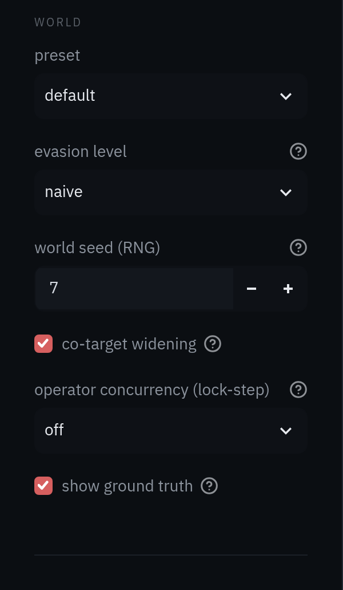

| Control | What it does |
|---|---|
| `preset` | `default` is a few thousand accounts; `smoke` is a tiny world for quick checks. |
| `evasion level` | How hard the rings try to look organic: `naive`, `moderate`, `sophisticated`. Each level is a separate world. |
| `world seed (RNG)` | Makes the world reproducible. Not the same thing as investigation *seeds*, which are accounts. |
| `co-target widening` | Lets retrieval widen along a ring's shared target creator. Needed at `sophisticated`. |
| `operator concurrency` | Builds a *lock-step* world where each ring can only run C accounts at once ([Act 4](#act-4--when-the-only-tell-is-time)). |
| `show ground truth` | Reveals the answer key (truth columns, badges, your score). Turn it off to work blind. |

Every control can be deep-linked, for example
`http://localhost:8501/?preset=default&level=naive&seed=7&rank=1`.

---

## Act 1 · Triage — find somewhere to start

The seeded engine needs a few accounts you already suspect. Nobody hands you those, so the
**Triage** page starts from nothing but events. It asks which **creators'** qualified views are
concentrated in ways organic popularity rarely produces.

Open the naive world: `/?preset=default&level=naive&seed=7`.

### Read the queue


The **concentration ranker** scored 36 creators above the impact floor and ranked them. Ground truth
is on, so the `truth` column and the *ring targets in top 16* tile show how it did: all 8 creators the
rings were paid to boost are in the top 16.

| Column | Meaning |
|---|---|
| `suspicion` | The highest of the creator's three entry-axis percentiles. 1.0 = the most concentrated in the pool. |
| `tags` | The observed contributor shape — a description, never a verdict. `multi-source` = many dedicated contributors (the coordination signal). `campaign` = the views pile into one week. |
| `n_eff` | Effective number of contributors. Low = a few accounts supply most views. |
| `boosters` | Accounts dedicated to this one creator. |
| `burst7` | Largest share of qualified views in any 7-day window. |
| `capped qv` | Payout-relevant impact, after the per-account daily cap. |

Notice the two kinds of rows that share the top of the list. Most are `multi-source, campaign` with
dozens of boosters — and every one of those is a ring target. Rows 3, 6 and 9 carry **no tags at
all**. They rank on `n_eff` alone, and they're organic. The rest of the page exists to tell those two
kinds apart.

### Why is creator 1 here?

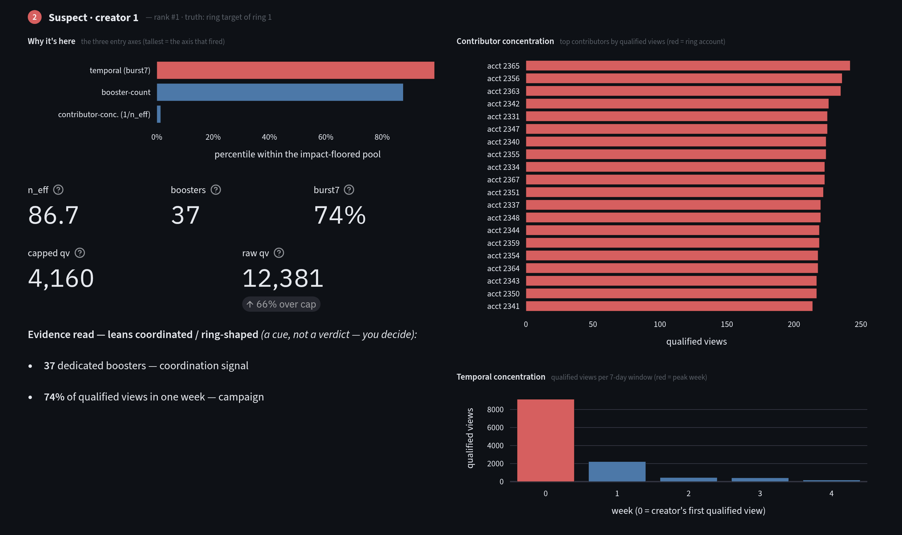

**Why it's here** shows creator 1's percentile on each entry axis. The red bar is the one that put
it on the list. Two axes fire hard here:

- **temporal** — `burst7` is 74%: three quarters of its qualified views landed in a single week;
- **booster-count** — 37 accounts each send at least 80% of all their qualified viewing to this one
  creator.

The **contributor concentration** chart is the picture behind those numbers. With truth on, ring
accounts are red, and the top twenty contributors are a wall of comparably sized red bars — a fleet,
not a fan. The **temporal** chart collapses into one tall week. `raw qv` is 12,381, but only 4,160
of it is payout-relevant: two thirds of the volume was over the per-account daily cap.

The **evidence read** at the bottom of the left column sums this up: *leans coordinated /
ring-shaped*. It is a cue, not a verdict.

### Look at the core

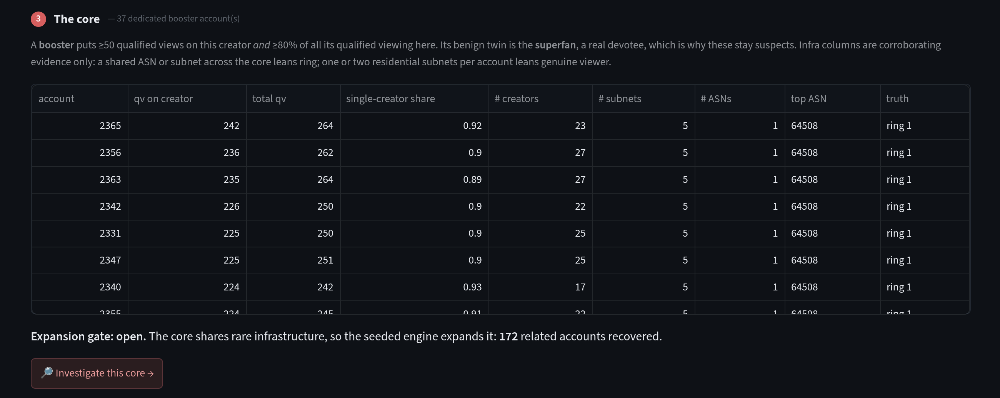

**The core** lists the 37 dedicated boosters. Read across one row: account 2365 put 242 of its 264
qualified views on creator 1 — a single-creator share of 0.92 — and touched 23 creators overall. The
infrastructure columns are evidence for you, not the ranker, which never reads them. Every core
account sits on the same ASN (64508) across just five subnets. One devoted fan doesn't come with 36
identical siblings on the same network.

The **expansion gate** says *open*: the core interlinks on rare infrastructure, so it's safe to hand
it to the seeded engine, which recovers 172 related accounts. When a core doesn't share infra, the
gate stays closed and the core itself is the output, because expanding would fan out into noise.

### Now the one that isn't a ring

Open rank 3 (`&rank=3`), creator 136:

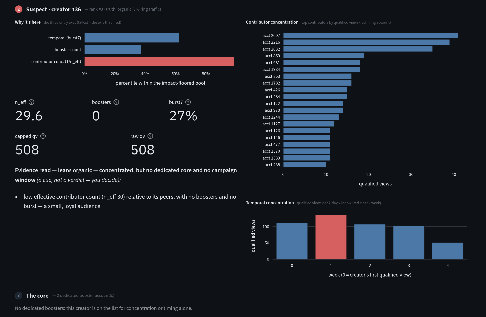

Same suspicion score, different story. Only **contributor concentration** fired: its `n_eff` of
29.6 is low for its volume. There are **no boosters**, `burst7` is an unremarkable 27%, and nothing
was capped. The contributors are a blue staircase, a few regulars and a long tail. The weekly chart is
flat across the month. The evidence read says *leans organic*. Truth agrees: only 7% of its qualified
views come from ring accounts, and those are cover traffic.

This is the case the tool is built around. A concentrated audience isn't fraud. A small creator with a
loyal following and a ring's target can share a suspicion score; the evidence separates them.

### Make your call

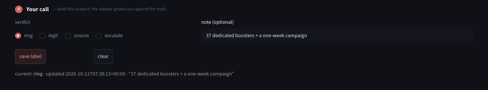

Label creator 1 **ring** and creator 136 **legit**. Use `unsure` for a genuinely ambiguous shape — a
single dedicated account looks identical whether it's a superfan or a lone operator — and `escalate`
for "needs another reviewer". Each label is saved with the creator's suspicion and rank at the time,
so a later pass can measure precision over the human's calls.

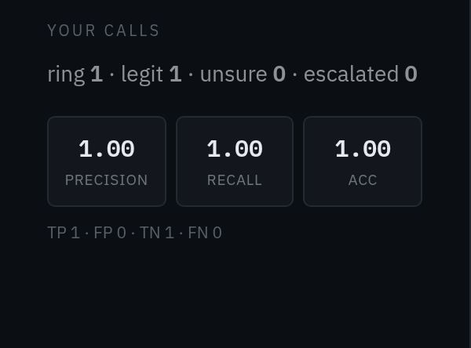

With ground truth on, the sidebar grades your calls. Turn it off to work blind, then turn it back on
for the reveal.

---

## Act 2 · Investigate — recover the ring

Back on creator 1, press **🔎 Investigate this core →** (or open `/investigate?…&creator=1`). The core
becomes the **seeds** for the Investigate page.

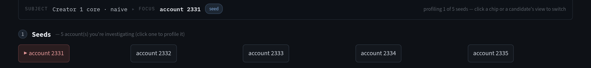

The breadcrumb keeps two things apart: **SUBJECT** is the case (*Creator 1 core · naive*), and
**FOCUS** is the one account on the slab. Click any seed chip to profile it.

### Profile one account

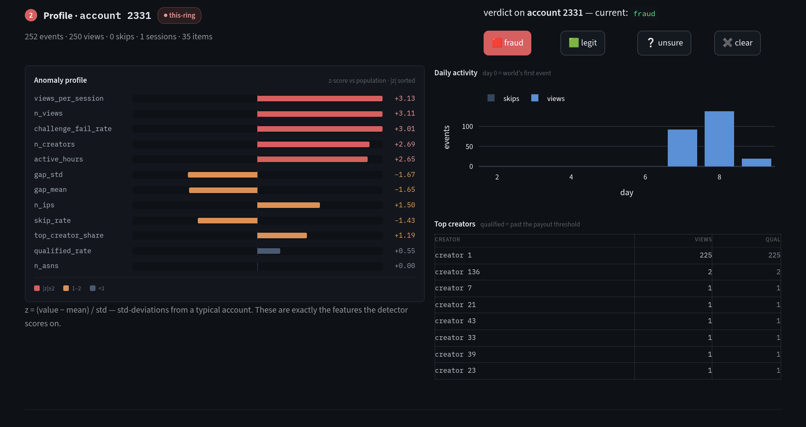

The **anomaly profile** shows every behavioral feature the engine scores, as a z-score against the
population. Seed 2331 is three standard deviations high on views per session, total views and
active-challenge failures, and spans far more hours of the day than a person does. **Top creators**
shows the economics: 225 of its views went to creator 1, all of them qualified, and only one or two
to each of a handful of others.

### Read the related accounts

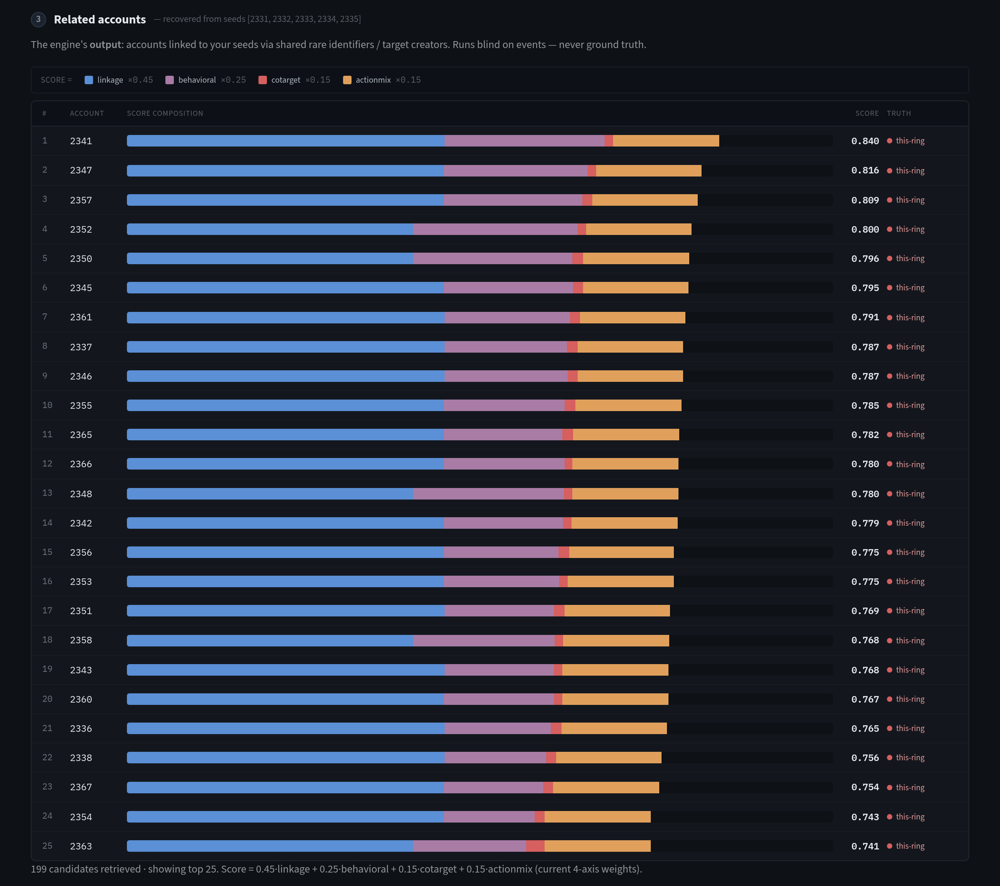

This is the engine's output: every account it linked to the seeds, ranked. It ran on events only.
Each bar is the score, split into its four weighted parts:

| Axis | Weight | What it measures |
|---|---|---|
| 🟦 linkage | ×0.45 | Shared *rare* identifiers with the seeds: IP, subnet, ASN, fingerprint, cookie, weighted by rarity. |
| 🟪 behavioral | ×0.25 | Closeness to the seeds' behavioral centroid. |
| 🟥 co-target | ×0.15 | Overlap with the seeds' target creator. |
| 🟧 action-mix | ×0.15 | Closeness in funnel shape and account age. |

At naive, the top 25 of 199 candidates are all **this-ring**, and blue dominates every bar: the ring
shares its datacenter infrastructure, so linkage alone nearly solves it.

### Inspect the evidence

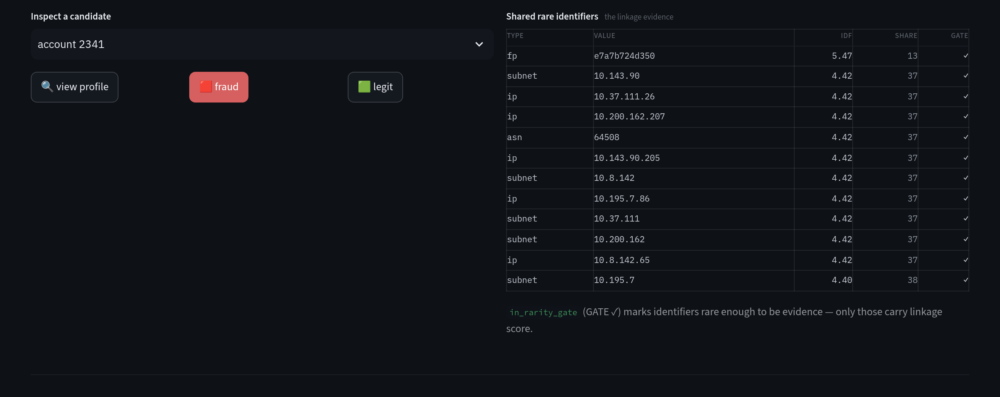

A rank is a claim; the inspector shows the evidence behind it. Account 2341 shares a device
fingerprint with the seeds that only 13 accounts in the world carry (IDF 5.47), plus several IPs and
subnets shared by exactly 37. The **gate** column marks identifiers inside the rarity gate. Only those
count. A mobile carrier shared by thousands would sit outside it and carry no linkage score.

### Explain the axes

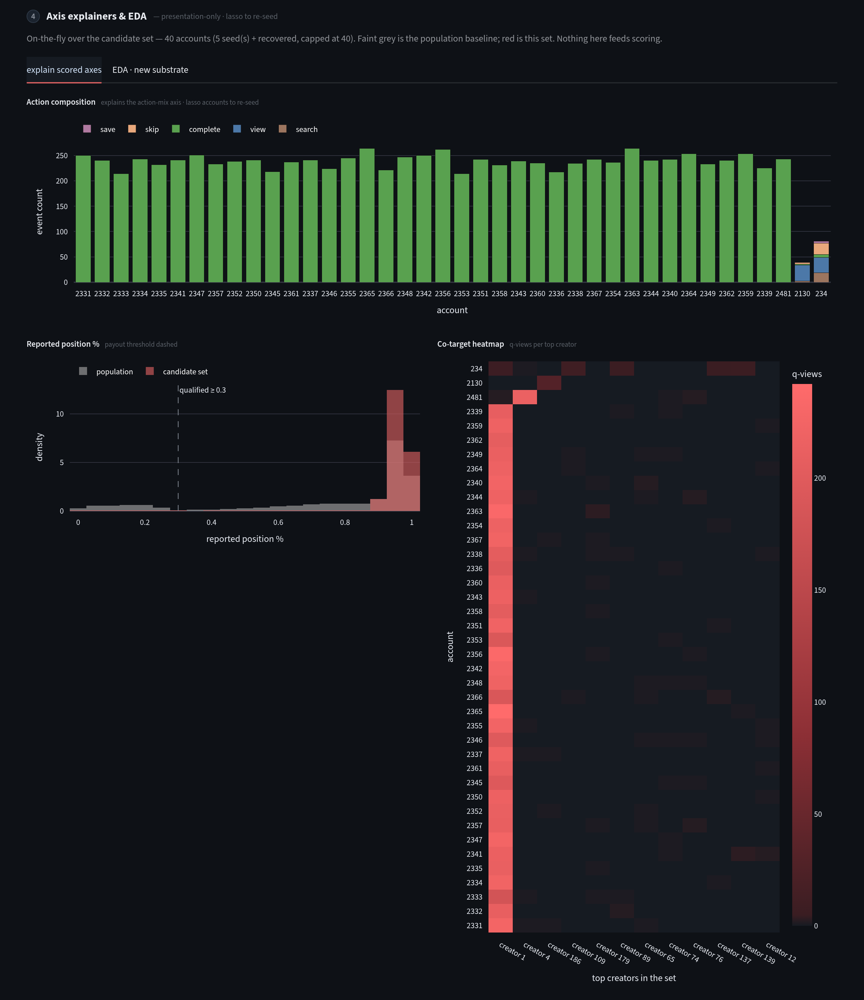

The charts draw the candidate set against the population baseline (grey). They are presentation-only
and never feed scoring.

- **Action composition** — almost every ring account is solid green: direct views that run to
  completion, with no searches and no saves. The two accounts on the right with a full funnel aren't
  ring members.
- **Reported position** — the ring stacks its client-reported progress just below 100%: a cheap
  completion spoof. Real viewing (grey) spreads across the whole range.
- **Co-target heatmap** — one bright column, creator 1. Everyone in the ring is paid to watch the same
  creator.

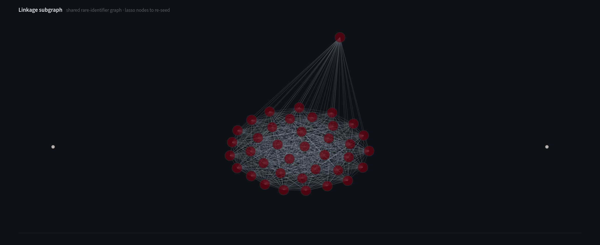

The **linkage subgraph** draws the primary evidence: accounts as nodes, shared gated identifiers as
edges. The ring is one densely wired clump. You can **lasso** nodes on this chart (or the action
composition, or the account-age strip) and re-run the investigation seeded on just your selection.

### Label and get graded

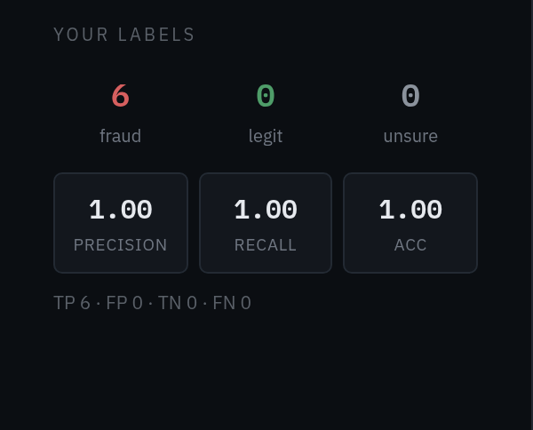

Label accounts **fraud**, **legit** or **unsure** from the profile header or the inspector. With
ground truth on, the sidebar keeps score.

---

## Act 3 · Turn the dial

Naive rings are easy by design. Switch the sidebar to `sophisticated` and investigate ring 1 from
three known members (`/investigate?…&level=sophisticated&ring=1`).

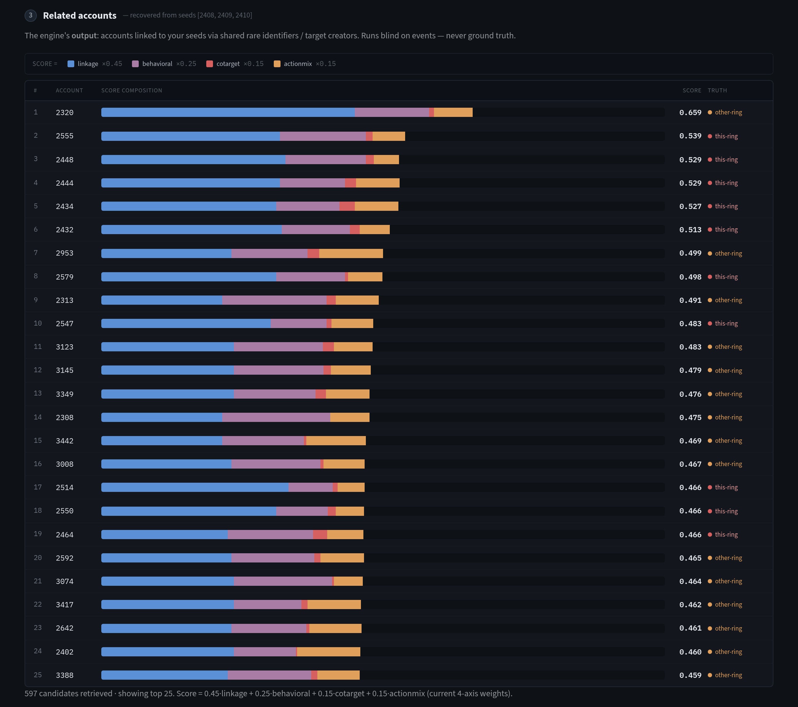

The picture changes:

- **Scores drop** from ~0.8 to ~0.5, and linkage shrinks. Sophisticated members sit on residential IPs,
  one or two each, so there's little rare infrastructure to share.
- **The candidate set balloons** to 597, because co-target widening casts a wider net.
- **this-ring and other-ring interleave.** The engine confuses this ring with others hitting
  overlapping creators. No genuine user makes the top 25. The loss is between rings, not into the
  legit population.

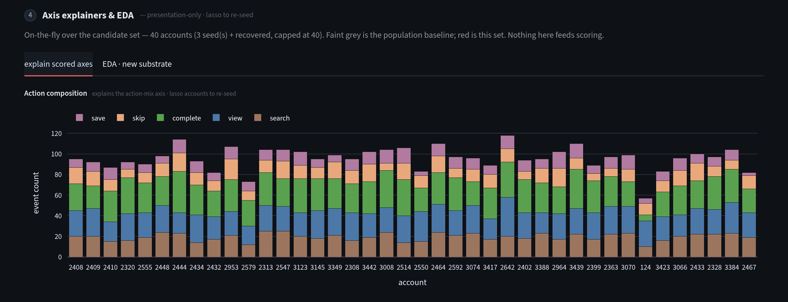

The **action composition** shows why the action-mix axis fades: sophisticated rings fake the whole
funnel — decoy searches, skips, saves — on aged accounts. Their bars look like everyone else's.

The triage queue changes too. At `moderate`, the tags disappear:

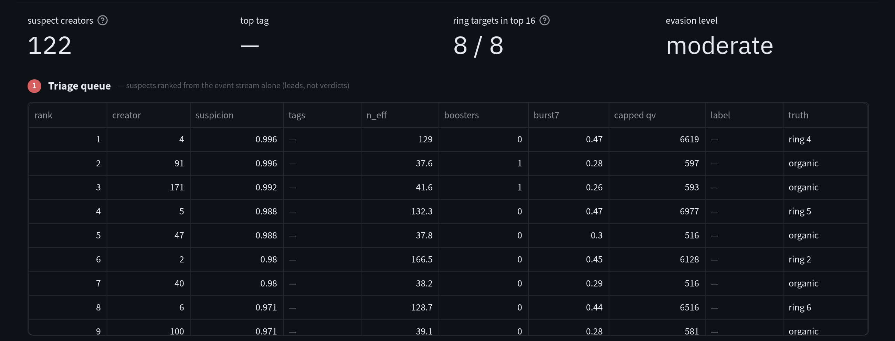

Rings now split their yield across more, lower-volume accounts, so no account clears the booster bar,
and `burst7` sits just under the campaign threshold. The ranker still puts all 8 ring targets in the
top 16 — they lead on the temporal axis — but they now interleave with organic creators, and the tags
no longer tell you which is which. That is the dial doing its job: it shows where each signal stops
helping. The measured curves are in the [README](../README.md#results).

This is also where the hand-weighted score stops being enough, and the **learned rule** takes over:
logistic regression over the weak signals, trained on rings it will never be graded on. At
sophisticated it lifts recall from 0.37 to 1.00 with legit false positives at 4%
([ADR 0003](adr/0003-held-out-rings-and-a-noisy-oracle.md)).

---

## Act 4 · When the only tell is time

Set **operator concurrency** to `4` (`&conc=4`). Each ring is now an operator that can only drive four
accounts at once, while a benign bandwagon piles onto the same creator in the same window, uncapped.
The cap is the *only* difference between them. A **temporal raster** appears at the bottom of the
Investigate page.

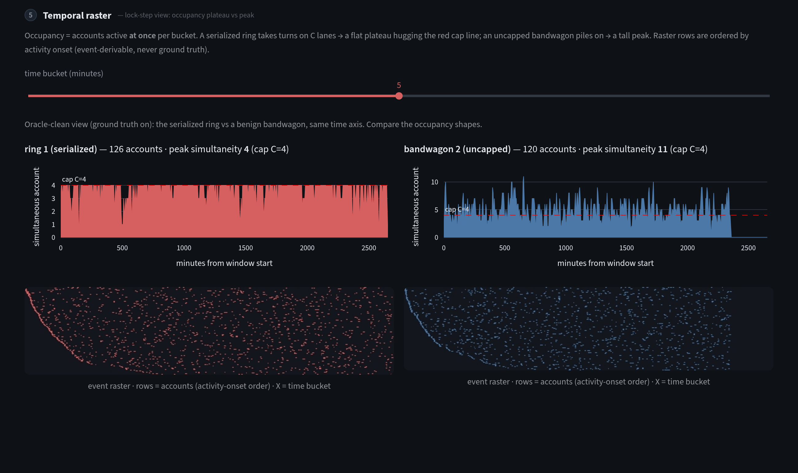

**Occupancy** is how many accounts are active at the same moment.

- **The serialized ring (left)** takes turns on its four lanes, so occupancy flattens into a plateau
  hugging the cap. Peak simultaneity: **4**, across 126 accounts.
- **The bandwagon (right)** piles on freely and spikes well above the line. Peak: **11**.

Below each strip, the **event raster** has one row per account, ordered by when each account first
appears — never by ground truth, which would hand the eye the answer.

A human reading these panels can confirm serialization. But no statistic computed from events
recovers it where it would matter: at sophisticated levels, the retrieved set is too polluted for the
plateau to show. That negative result is written up with its numbers in
[ADR 0004](adr/0004-lockstep-serialization-is-not-recoverable.md). The raster ships as an analyst aid,
not a feature.

---

## What you just did

1. **Triage** ranked creators from raw events, with no labels and no seeds, and put every ring's target
   near the top.
2. You told a ring-shaped core from a loyal small audience using the evidence, not the score.
3. **The handoff** turned that core into seeds, and the engine recovered the rest of the ring.
4. **The dial** showed where each signal stops working, and why the method reports curves rather
   than a single number.
5. **The lock-step world** showed a signal that is real, human-readable, and still not a detector
   feature — documented as such.

Next: how the pieces are measured ([method](research/method.md)), why each design choice was made
([ADRs](adr/)), and what the field already knew ([literature review](research/literature-review.md)).
For the plain-language version of the scoring, see the [explainer lessons](explainer/).
